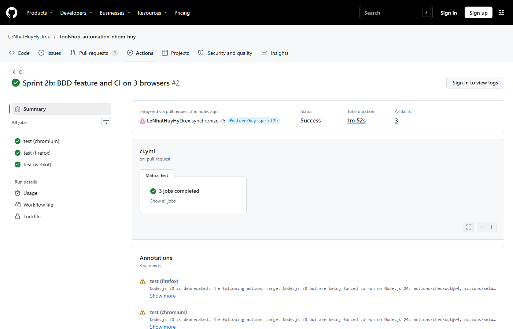
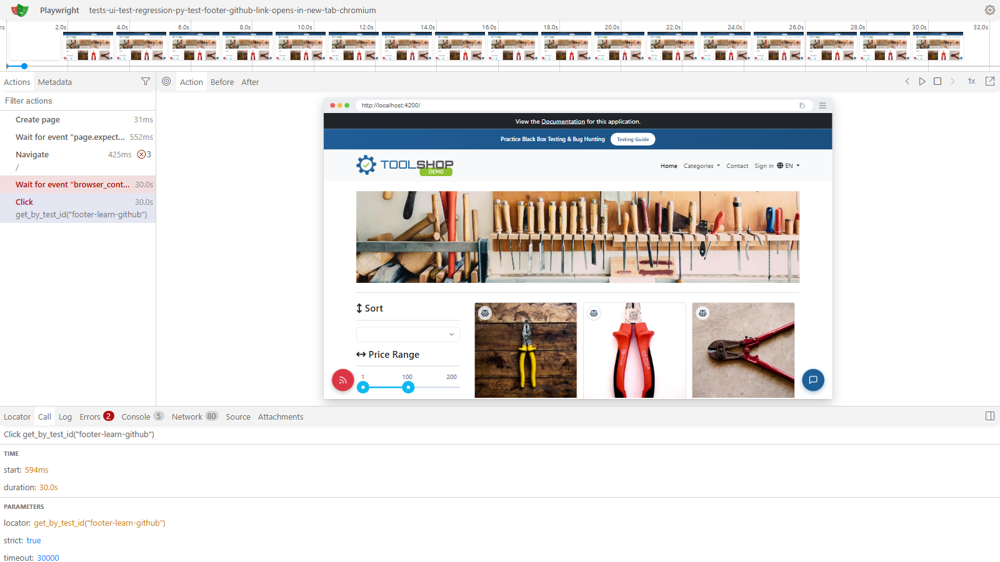

# Toolshop Automation - nhóm Huy


Bộ kiểm thử tự động cho Toolshop (https://practicesoftwaretesting.com) viết bằng Playwright và pytest, theo mô hình Page Object.

## Thành viên

| Họ và tên | MSV | GitHub |
|---|---|---|
| Lê Nhật Huy (trưởng nhóm) | 23IT102 | LeNhatHuyHyDrex |
| Nguyễn Thị Thùy Tiến | 23IT273 | Tien-01012005 |
| Trần Kim Thịnh | 23IT264 | TranKimThinh |

## Cài đặt (Windows PowerShell)

```powershell
git clone https://github.com/LeNhatHuyHyDrex/toolshop-automation-nhom-huy.git
cd toolshop-automation-nhom-huy
py -3.12 -m venv .venv
.venv\Scripts\activate
pip install -r requirements.txt
playwright install chromium
copy .env.example .env
```

## Chạy test

```powershell
pytest -m smoke          # 4 test smoke
pytest -m regression     # test hồi quy
pytest tests/bdd -v      # feature BDD (giỏ hàng)
pytest --headed --slowmo 300   # xem trình duyệt chạy chậm
```

## Cấu trúc

```
pages/        page object: locator và thao tác của từng trang
tests/ui/     test giao diện, chỉ chứa kịch bản và assertion
tests/api/    test API (APIRequestContext)
tests/bdd/    feature Gherkin và step definition (pytest-bdd)
toolshop/     Docker Compose dựng Toolshop riêng cho CI
.github/      workflow CI chạy 3 trình duyệt
conftest.py   fixture dùng chung, đọc cấu hình từ .env
pytest.ini    khai báo marker
```

## Quy tắc của nhóm

1. Locator chỉ nằm trong `pages/`, assertion chỉ nằm trong `tests/`.
2. Không dùng `time.sleep()` hay `wait_for_timeout()`, chờ bằng `expect()`.
3. Không assert số lượng tuyệt đối hay id cụ thể.
4. Mỗi test có docstring 3 ý: mục tiêu, tiền điều kiện, kết quả mong đợi.
5. Không dùng tài khoản dùng chung để thử đăng nhập sai.
6. Nhánh `main` chỉ nhận Pull Request và cần 1 người khác review.
7. Không đẩy file `.env` lên GitHub.

## Kết quả CI

Mỗi push vào `main` và mỗi Pull Request chạy cả bộ test trên Chromium, Firefox, WebKit (workflow `.github/workflows/ci.yml`). CI tự dựng Toolshop bằng Docker (`toolshop/`) vì site công khai chặn trình duyệt chạy trên máy của GitHub.



## Trace Viewer

Khi test đỏ, CI giữ trace và báo cáo trong artifact `report-<trình duyệt>`. Ảnh dưới là trace của lượt đỏ đầu tiên (locator footer GitHub không có trên Toolshop dựng cho CI), mở bằng `playwright show-trace`.


